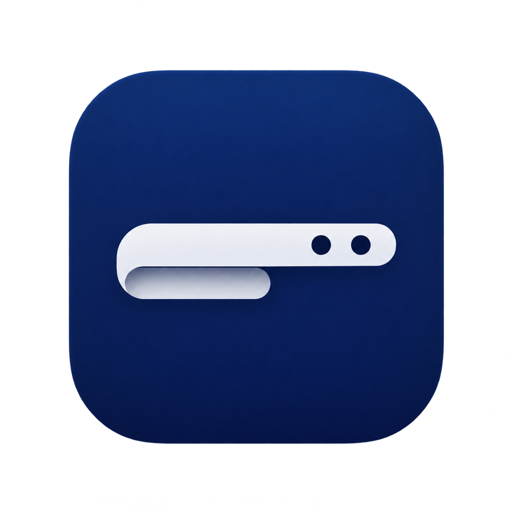

<p align="center">
  
</p>

# 菜单栏收纳（BarFold）

原生 macOS 菜单栏工具，支持常驻显示、收起、永久隐藏三种状态。用 SwiftUI 提供配置面板，用 AppKit 提供菜单栏入口；配置保存到本机 UserDefaults。

## 下载安装（普通用户）

要求 **macOS 27.0 及以上**（Apple Silicon `arm64`）。

1. 前往 [GitHub Releases](https://github.com/CuriosityWang/BarFold/releases) 下载最新的 `BarFold-v0.2.0-macOS-arm64.dmg`（或 `.zip`）。
2. 打开 `.dmg`，将 **BarFold.app** 拖入右侧系统的 **`/Applications`（应用程序）** 文件夹（必须放在系统 `/Applications` 下，不可放在下载目录或 `~/Applications`）。
3. 由于安装包采用开源 Ad-hoc 签名（未经过 Apple 付费开发者公证），首次打开前请在终端执行一行命令移除系统下载隔离标记：
   ```sh
   xattr -cr /Applications/BarFold.app
   ```
4. 打开 `/Applications/BarFold.app`，按提示授予“辅助功能”权限即可使用。

## 使用

应用必须安装到系统 `/Applications` 目录。本机 macOS 27.2 的运行测试发现：构建目录和用户 `~/Applications` 目录中的应用，即使在允许显示列表中，也可能被系统一起隐藏。因此，放错位置的 BarFold 会禁用图标管理并提示移动。

1. 打开 `/Applications/BarFold.app`。已有配置且权限就绪时，应用在菜单栏静默启动；首次配置或缺少权限时会自动打开面板。
2. 在面板中点击“打开权限设置”，允许 BarFold 的辅助功能权限，然后回到应用点击“刷新图标”。图标管理需要辅助功能权限。
3. 为应用选择显示方式。新识别的应用默认常驻显示；同一应用的多个图标一起显隐。嵌套在主应用内的辅助进程会自动附加主应用名称（如 `Feishu (Lark Helper)`）。
4. 左键点击菜单栏箭头（或启用全局快捷键 `⌥⌘B`），在系统菜单栏中向左展开或收起。右键打开配置、切换登录时启动、暂停管理或退出。
5. 可在面板顶部配置登录时启动、全局快捷键 `⌥⌘B` 以及展开后自动收起延迟（不自动收起 / 10 秒 / 15 秒 / 30 秒；面板打开或鼠标停留在菜单栏区域时不会打断收起）。
6. 若隐藏期间新启动了被系统连带隐藏的应用，可点击底部“发现隐藏图标”短暂恢复全部图标完成扫描。未运行应用的保留规则可一键移除。

菜单栏从左到右按“收起图标、BarFold 箭头、常驻图标、系统图标”排列。BarFold 箭头位于常驻区左侧。展开时，收起图标在 BarFold 箭头左侧显示，BarFold 箭头和右侧常驻图标保持原位。

改变应用分组时，BarFold 会通过系统的 ⌘ 拖动操作调整位置。选择“收起”会将图标移到 BarFold 箭头左侧，选择“常驻显示”会将图标移到右侧。展开时也会检查已有配置的位置。位置调整会等待鼠标和修饰键松开，用户继续操作鼠标或键盘时会中断调整。未完成的调整会在面板中提示，可点击“恢复管理”重试。

菜单栏空间不足时，展开操作会自动打开 macOS 的双箭头溢出区，收起时同步关闭。程序通过屏幕坐标命中实际按钮并读取开合状态，避免后台菜单栏副本导致重复开关。在本机刘海屏上，已验证一次展开后飞书、QQ、PasteEasy、Snipaste 同时可见，溢出项目显示在刘海左侧。

| 状态 | 收起时 | 展开时 |
|---|---|---|
| 常驻显示 | 显示 | 显示 |
| 收起 | 隐藏 | 显示 |
| 永久隐藏 | 隐藏 | 隐藏；在配置中改回常驻显示即可恢复 |

“暂停并恢复图标”解除 BarFold 施加的隐藏，保留配置。退出也会释放隐藏状态；其他工具或系统设置造成的隐藏不由 BarFold 覆盖。配置面板可保留已退出应用的设置。

## 系统限制

- 首版只针对 macOS 27 开发。显隐依赖运行时加载的私有 `MenuBarClientCore` 接口，系统更新后需要重新验证。接口缺失或请求失败时释放隐藏状态，并在面板提示。
- 在本机 macOS 27.2（26B123）实测，隐藏测试应用期间，Wi-Fi、音量、电池、时钟、控制中心保持显示；专注模式图标暂时消失，解除隐藏后恢复。
- 同类实现还记录了正在播放、摄像头控制和点击时钟打开通知中心受到影响的情况，尚未在本机逐项验收。需要这些功能时，可点击“暂停并恢复图标”。参考 [JustHide 的接口限制说明](https://github.com/benjustjammin/justhide#keeping-the-camera-button-and-live-activities)。
- 不在系统应用程序目录中的应用、没有独立应用身份的辅助进程，可能不遵守允许显示列表。首版无法为这类进程保证独立显隐。
- 展开使用系统原生菜单栏图标，图标和状态由各应用自行更新。可用空间仍受屏幕宽度和刘海区域限制。
- 本机已配置固定的本地代码签名证书 `BarFold Development`，证书和私钥保存在登录钥匙串中。构建脚本从 `.signing-identity` 读取证书指纹，并检查更新前后的应用身份是否一致。首次切换到证书签名需要重新授权一次。

## 构建与验证

需要 Xcode 和 macOS 27。无外部包依赖。

```sh
swift test
zsh scripts/build-app.sh
zsh scripts/install-app.sh
zsh scripts/package-release.sh
```

构建产物为 `dist/BarFold.app`；公开分发包产物位于 `dist/release-v*/`（含 `.dmg`、`.zip` 与 `SHA256SUMS.txt`）。安装脚本仅替换标识符为 `local.barfold.app` 的同名应用，退出本项目的运行副本后安装到 `/Applications/BarFold.app` 并打开。

`.signing-identity` 是本机配置，已加入 Git 忽略列表。此文件只保存公开的证书指纹。保留登录钥匙串中的 `BarFold Development` 证书及其私钥，后续构建会复用该身份。证书不可用时签名步骤报错。新环境尚未配置该文件时，构建脚本使用临时签名并输出提示。

```sh
zsh scripts/native-smoke.sh
```

运行原生测试前，在 BarFold 中点击“暂停并恢复图标”，以免两个进程同时设置菜单栏可见性。测试结束后恢复管理。

原生测试在 `/Applications/BarFoldSmoke.*` 临时创建三个独立测试应用，验证收起、展开、永久隐藏、系统图标保留、释放恢复和请求取消。测试结束后退出并清理这些测试应用。运行期间菜单栏会短暂变化，需要执行环境具备辅助功能权限；不改动用户的分组配置。

源码入口：

- `Sources/BarFoldCore/Visibility.swift`：三状态规则与本地保存。
- `Sources/BarFoldCore/Preferences.swift`：自动收起延迟、全局快捷键配置与策略。
- `Sources/BarFoldCore/AppIdentity.swift`：嵌套辅助进程宿主应用识别与启动弹窗策略。
- `Sources/BarFoldCore/InventoryCatalog.swift`：后台进程过滤与菜单栏列表聚合。
- `Sources/BarFoldCore/MenuBarOrder.swift`：菜单栏锚点左右分区顺序计算。
- `Sources/BarFoldCore/MenuBarOverflow.swift`：macOS 双箭头溢出控件合并与状态判定。
- `Sources/BarFold/Inventory.swift`：从系统菜单栏辅助功能树识别应用与屏幕布局。
- `Sources/BarFold/MenuBarMover.swift`：空闲检测与可中断的 ⌘ 拖拽排序。
- `Sources/BarFold/HotKey.swift`：全局快捷键 `⌥⌘B` 注册与释放。
- `Sources/MenuBarBridge/MenuBarBridge.m`：私有接口检测、异步更新、超时与恢复。
- `Sources/BarFold/AppModel.swift`：连接配置、应用启动退出、显示器与空间变化、自动收起与登录启动。
- `Sources/BarFold/SettingsView.swift`：配置面板与 32×32 图标缩略图缓存。
- `scripts/package-release.sh`：生成公开分发的 `.dmg`、`.zip` 与 `SHA256SUMS.txt`。

界面点击、权限授权、睡眠唤醒和显示器热插拔需要人工验收；构建通过和原生测试通过不代表这些场景已经验证。

接口线索来自 [Pelmet / Dimble](https://github.com/fif7y/dimble) 与 [JustHide](https://github.com/benjustjammin/justhide)，接口签名及基本行为在本机单独探测后实现。本项目没有引入它们的源码或运行依赖。
